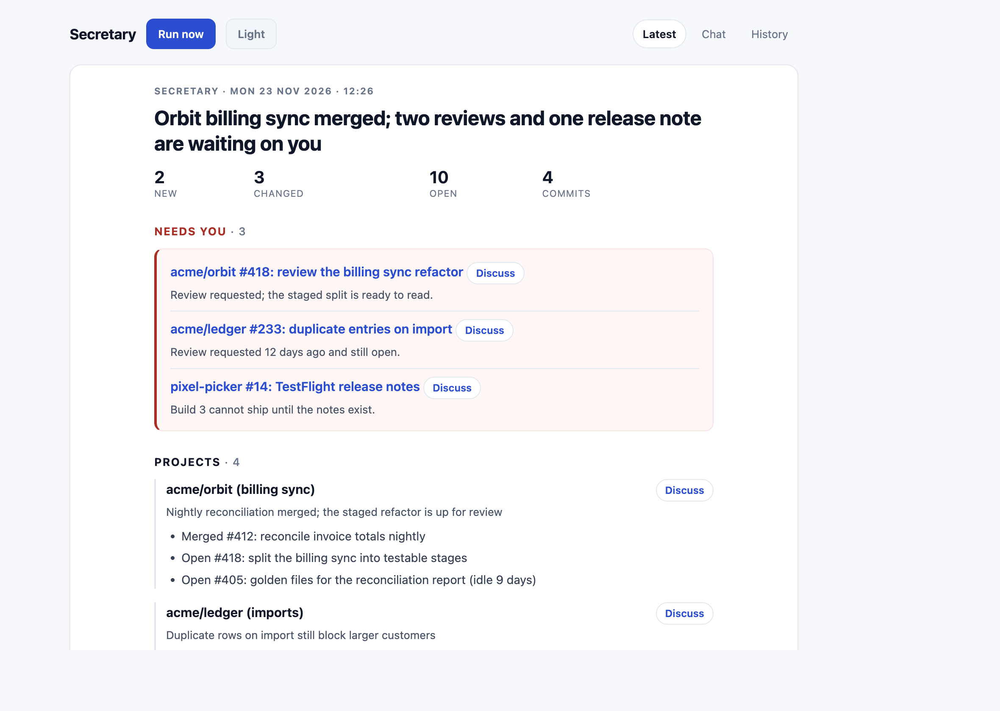
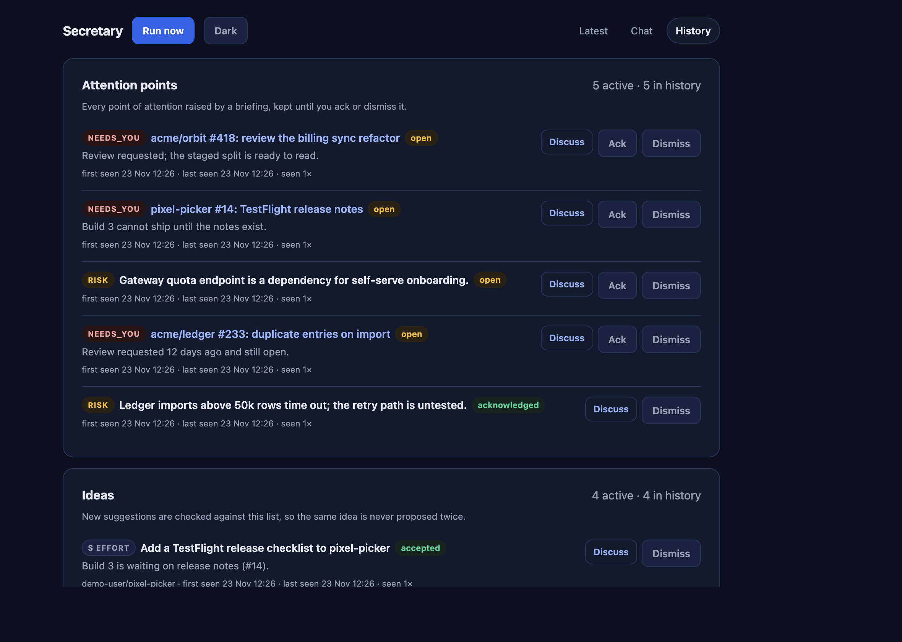
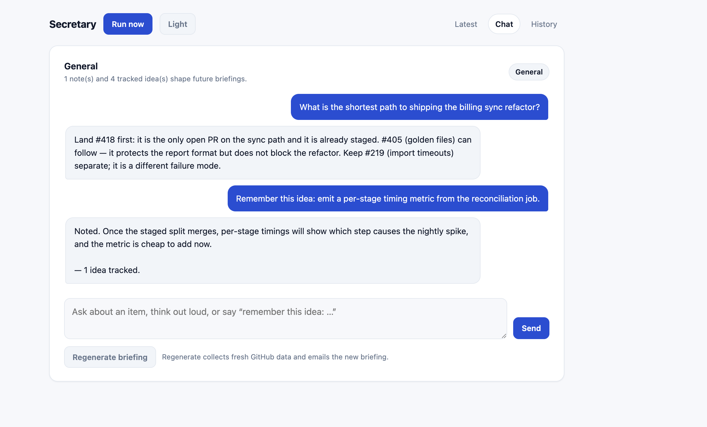

# agent-monitor — a personal engineering secretary

Watches your GitHub work, writes a short briefing twice a day, emails it and keeps a
dashboard with a durable history of everything that needs attention. It also holds a
conversation about any item, idea or alert in that history.

No database, no service, no account: state is plain JSON/JSONL files under `store/`, and
the only network calls are to `gh`, your mail host and the model you choose.



## What you get

- **Twice-daily briefings** — progress, what needs *you*, risks and concrete ideas,
  written by an LLM from a diff of your GitHub activity.
- **Email + dashboard** — a formatted HTML email and a local page at
  <http://127.0.0.1:8787> with Latest / Chat / History.
- **History that doesn't forget** — every point of attention and every idea is stored as
  its own file with first seen, last seen and a seen count. Acknowledge, dismiss or
  reopen it; nothing disappears when the next briefing arrives.
- **Two-way chat** — every entry in the briefing (each needs-you row, project, idea, risk
  and next action) has a **Discuss** button that opens its own thread, grounded in that
  entry plus the current briefing. Say "remember this idea: …" and it joins the ledger;
  state a priority and it becomes a note that shapes future briefings.
- **Incremental and non-repeating** — PRs, issues and commits are diffed against the last
  run, and new ideas are checked against the ledger, so the same suggestion is never made
  twice (including close paraphrases).
- **Light and dark themes**, following the OS by default, with a per-browser toggle.
- **Resilient runs** — if the model is unavailable you still get a deterministic summary
  marked "degraded"; a run lock prevents overlapping digests; email failures don't lose
  the briefing.



## Requirements

- Python 3.11+ (standard library only).
- [`gh`](https://cli.github.com/) authenticated with `repo` + `read:org`.
- An LLM: `claude_cli` (uses your Claude sign-in through `npx`) or an API key for
  Anthropic, OpenAI, DeepSeek, Gemini or OpenRouter.
- Optional: key-based SSH to a mail host for `sendmail_ssh`, or SMTP credentials.

## Quick start

```sh
git clone https://github.com/ondrej-li/agent-monitor
cd agent-monitor
./bin/agent-monitor init                 # writes config.toml from a template
$EDITOR config.toml                      # your login, repos, domains, email
./bin/agent-monitor set-key ANTHROPIC_API_KEY   # hidden prompt; or use claude_cli
./bin/agent-monitor doctor
./bin/agent-monitor run --no-email       # first briefing, no mail
./bin/agent-monitor install              # launchd: digests at 08:00/18:00 + dashboard
```

## Try the demo

The screenshots above use a fictional dataset (fictional people, repositories and links):

```sh
python3 scripts/make_demo.py
python3 -m monitor.cli --config demo/config.toml serve   # http://127.0.0.1:8788
```

`scripts/make_demo.py` regenerates `demo/store` and `demo/digests` from scratch, so no
real account is needed to see the UI.

## Commands

| Command | What it does |
| --- | --- |
| `init [--force]` | Write a starter `config.toml`. |
| `set-key NAME` | Store a secret in `~/.config/agent-monitor/env` (mode 600, hidden prompt). |
| `collect [--json] [--since-hours N]` | Collect GitHub data and print a summary. |
| `run [--no-email] [--provider P] [--since-hours N]` | Collect, think, record, render, deliver. |
| `serve [--port N]` | Run the dashboard in the foreground. |
| `doctor` | Check config, gh auth, the store, the LLM key, mail, dashboard and launchd. |
| `install [--no-link]` / `uninstall` | Manage the launchd jobs. |
| `ask "..." [--thread T]` | Chat with the secretary from the terminal. |
| `ideas list\|accept ID\|dismiss ID` | Inspect or curate the idea files. |
| `render [PATH]` | Re-render an existing digest without calling the model. |
| `status` | Recent runs with counts and errors. |
| `test-email` | Send a delivery test. |

## How a run works

1. **Collect** (`monitor/gh.py`) — `gh search` for PRs and issues involving you (open
   items plus anything updated since the last run), commits authored by you, and the repo
   list. Your open PRs and review requests get a detail fetch (checks, review decision,
   mergeability, diff size).
2. **Diff** (`monitor/store.py`) — every item is classified `new`, `changed` or
   `unchanged` against `store/items.json`. Items idle 7–45 days are "fresh idle"; older
   ones collapse into a low-priority "parked" bucket.
3. **Think** (`monitor/digest.py`, `monitor/llm.py`) — a strict JSON prompt asks for
   `headline`, `needs_you`, `projects`, `ideas`, `risks`, `next_actions`. Invented links
   are dropped; repeated ideas are discarded against the ledger.
4. **Record** (`monitor/store.py`) — attention points and ideas become individual files;
   alerts that reappear bump their seen count instead of duplicating.
5. **Render + deliver** (`monitor/render.py`, `monitor/deliver.py`) — markdown, HTML and
   JSON land in `digests/`; email goes out via SMTP or local `sendmail` over SSH.



## Configuration

`config.toml` is created by `init` and ignored by git. The parts worth knowing:

```toml
[general]
run_times = ["08:00", "18:00"]
lookback_hours = 36
stale_after_days = 7
stale_repo_days = 90
port = 8787

[identity]
login = "your-github-login"
name = "Your Name"
bio = """Short description of your work; steers the ideas."""
domains = ["the systems you own", "the projects you maintain"]

[github]
orgs = ["your-company"]          # optional
repos = ["your-company/main"]    # always included, optional
own_repos = true                 # every repo under your login
priority_repos = ["you/main-project"]

[llm]
provider = "anthropic"           # anthropic | openai | deepseek | gemini | openrouter | claude_cli
model = "claude-sonnet-4-5"
fallback_provider = "claude_cli"

[email]
to = ["you@example.com"]
from = "Agent Monitor <agent@example.com>"
transport = "sendmail_ssh"       # sendmail_ssh | smtp
ssh_host = "deploy@example.com"
```

### Secrets

Resolution order: environment → `~/.config/agent-monitor/env` → macOS login keychain.

```sh
./bin/agent-monitor set-key ANTHROPIC_API_KEY
# or
security add-generic-password -s agent-monitor -a ANTHROPIC_API_KEY -w
```

Default secret names: `ANTHROPIC_API_KEY`, `OPENAI_API_KEY`, `DEEPSEEK_API_KEY`,
`GEMINI_API_KEY`, `OPENROUTER_API_KEY`, `AGENT_MONITOR_SMTP_PASSWORD`.

### Email transports

- `sendmail_ssh` (default) — pipes the message to `/usr/sbin/sendmail` on the mail host
  over SSH. Postfix trusts `127.0.0.1`, so no SMTP password is stored locally.
- `smtp` — `smtp_host`, `smtp_port`, `smtp_security` (`ssl`/`starttls`/`none`),
  `smtp_user`, and the password from `smtp_password_secret`.

## Storage: files, not a database

```
store/
  items.json          tracked PRs/issues with first/last seen
  commits.json        recent authored commits
  state.json          last_success_at etc.
  ideas/<id>.json     one file per idea (status, seen count)
  alerts/<id>.json    one file per point of attention
  notes/<id>.json     priorities captured in chat
  runs/<id>.json      run log
  chats/<hash>.jsonl  chat threads + chats/index.json
```

Human-readable, greppable, easy to back up. `store/`, `digests/` and `logs/` are
gitignored because they contain real work data.

## History and chat

`/history` has three sections:

- **Attention points** — each `needs_you` entry and risk from every briefing, deduped by
  fingerprint. Repeat appearances bump the seen count. Ack / Dismiss / Reopen, and
  **Discuss**.
- **Ideas** — the ledger with effort, area, first/last seen, Accept / Dismiss / Reopen and
  **Discuss**.
- **Runs** — status, model, counts, duration and errors.

Threads are addressed as `general`, `item:owner/repo#123`, `idea:<id>` and `alert:<id>`,
so any historical entry can become a conversation.

## Dashboard and themes

<http://127.0.0.1:8787> binds to loopback only:

- `/` latest briefing, **Run now**, *discuss* links on items
- `/chat` chat threads
- `/history` attention points, ideas and runs
- `/health` JSON status
- `/api/run` live run state (stage, message, percent, elapsed) used by the progress bar

The theme follows the OS by default; the header toggle cycles **Auto → Light → Dark** and
is remembered per browser. Email is always light, as email clients expect.

## Scheduling

`install` writes two LaunchAgents (`local.agent-monitor.digest` and
`local.agent-monitor.server`) and bootstraps them:

- digest runs at each time in `run_times`;
- the server keeps the dashboard alive at login and after crashes.

Logs: `logs/digest.*.log`, `logs/server.*.log`, `logs/run.log`.

## Troubleshooting

- Start with `doctor` — it checks config, `gh` auth, store, LLM key, mail reachability,
  dashboard and launchd.
- **Claude subscription sign-in expires.** For unattended runs add `ANTHROPIC_API_KEY` or
  run `claude setup-token`. Until then `fallback_provider = "claude_cli"` keeps working
  while the CLI is signed in.
- Chat replies and digests are slow on the CLI provider (one model call each). An API key
  brings them to seconds.
- `status` shows recent runs, including email errors.

## Layout

```
monitor/     config, gh collector, file store, llm providers, digest, chat, render,
             deliver, server, cli
bin/         agent-monitor wrapper
scripts/     demo data generator
tests/       unit tests (python3 -m unittest discover -s tests)
docs/        screenshots used by this README
```
